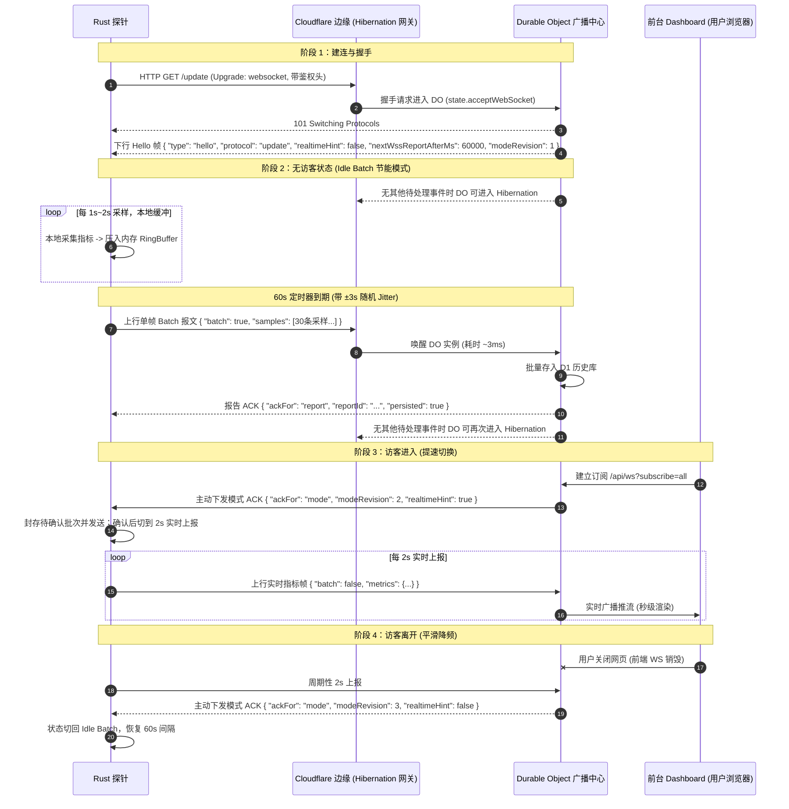
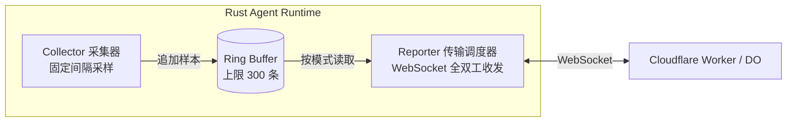

# Serverless Monitor Agent - WebSocket 自适应动态上报技术对接规范

本文档面向 **Serverless Monitor Agent (`serverless-monitor-agent`, Rust 实现)** 的开发团队与 AI 助手，明确了服务端与探针之间基于 **WebSocket Hibernation（休眠机制）** 的自适应动态上报架构、报文格式、状态机迁移逻辑以及容灾策略。

---

## 1. 架构目标与背景

### 1.1 痛点与收益
- **现状估算**：若 2 秒业务上报使 DO 无法进入 Hibernation，按约 `0.125 GB × 24 小时` 估算，每日约为 **10,800 GB-s**（具体占比取决于所用 Cloudflare 计划及其他工作负载）。这不是所有部署的固定成本值。
- **优化原理**：
  - **无访客浏览看盘时（节能低频模式）**：Agent 维持 WebSocket 长连接，在本地按短间隔采集并缓冲指标，每约 60 秒（可动态协商）发送批次。DO 可在没有其他事件的空闲时段进入 Hibernation；每个批次仍会唤醒 DO 处理并产生相应开销。
  - **有访客打开看板时（实时推流模式）**：前台用户连入触发 DO 唤醒，DO 毫秒级通过 WebSocket 下行向所有已连接的 Agent 发送提速指令（`realtimeHint: true, nextWssReportAfterMs: 2000`）。Agent 立即切换为 2 秒实时推送，前台仪表盘秒级联动。
  - **访客关闭网页时（平滑降频）**：最后一个前端 WS 订阅断开后，服务端主动下发带新版本号的模式 ACK，指示 Agent 回退至 60 秒批量上报。DO 在后续没有其他事件时可再次进入 Hibernation。
- **目标收益**：减少无访客时的上报频率，同时保留看板打开后的实时数据。实际 DO Duration 取决于 DO 分片方式、同一 DO 上其他 Agent 的消息频率、每次处理时长及 D1 写入；应以生产负载测试结果为准，不保证固定降至某一比例或为零。

> **服务端部署约束**：hibernation 只会在 DO 没有待处理事件且符合休眠条件时发生。Agent 的每个业务数据帧都会唤醒接收该帧的 DO。如果一个广播 DO 同时承载大量 Agent，分散到达的 60 秒批次仍可能让它持续活跃。服务端必须评估按节点或小规模分片接入 Agent、由单独的看板层聚合实时数据；若采用共享 DO，须实测并接受它可能无法充分休眠。

---

## 2. 通信拓扑与协议生命周期



---

## 3. 协议帧格式规范 (Protocol Frames Specification)

通信双方统一采用标准 UTF-8 JSON 文本帧传输。

### 3.1 建连握手（Client Handshake）
- **URL**: `wss://<YOUR_WORKER_DOMAIN>/update`
- **Headers**:
  ```http
  GET /update HTTP/1.1
  Host: monitor.example.com
  Upgrade: websocket
  Connection: Upgrade
  Sec-WebSocket-Key: dGhlIHNhbXBsZSBub25jZQ==
  Sec-WebSocket-Version: 13
  User-Agent: serverless-monitor-agent/1.1.0
  X-Agent-Version: 1.1.0
  X-Agent-Config-Schema: 7
  X-Agent-Config-Md5: <本地当前配置的MD5（可选）>
  ```

### 3.2 服务端下行报文 (Server -> Agent)

#### 1. 建连欢迎帧 (`type: "hello"`)
服务端在握手成功（DO Hibernation 接管连接）后向探针发送的第一帧数据，**必须内含建连时看板访客状态的初始模式**：
```json
{
  "type": "hello",
  "ts": 1729800000000,
  "protocol": "update",
  "realtimeHint": false,
  "nextWssReportAfterMs": 60000,
  "modeRevision": 1
}
```
* **核心下行字段**：
  * `realtimeHint` (`bool`): **建连时前台是否有活跃访客**。
    * 若为 `true`：看板已有用户在浏览，探针**直接初始化为实时模式**（2秒上报）。
    * 若为 `false`：看板无用户，探针**直接初始化为节能模式**（完成首次连接校验后进入60秒批量上报）。
  * `nextWssReportAfterMs` (`u64`): 当前模式下后续上报周期建议（毫秒，实时通常为 `2000`，节能通常为 `60000`）。首个连接快照应立即发送，不等待该间隔。
  * `modeRevision` (`u64`): 此 Agent 会话的模式版本号。服务端每次改变该 Agent 的有效模式时递增，并在 DO 休眠恢复后保持单调递增。

#### 2. 应答与调度帧 (`type: "ack"`)
服务端仍使用 `type: "ack"`，但必须区分报告确认和模式推送。两者都不能互相代替。

**报告确认**只确认一条 Agent 上报，不携带模式字段：
```json
{
  "type": "ack",
  "ackFor": "report",
  "ts": 1729800060000,
  "reportId": "srv-us-east-01-00000042",
  "accepted": true,
  "persisted": true,
  "acceptedSamples": 30,
  "nextD1WriteAfterMs": 0,
  "config": "collect_interval=2&report_interval=60&...",
  "config_md5": "d41d8cd98f00b204e9800998ecf8427e"
}
```

**模式推送**可以由看板访客状态变化触发，不确认任何报告：
```json
{
  "type": "ack",
  "ackFor": "mode",
  "ts": 1729800060000,
  "modeRevision": 2,
  "nextWssReportAfterMs": 2000,
  "realtimeHint": true
}
```

* **核心字段说明**：
  * `ackFor` (`string`): 自适应 ACK 必填，只允许 `report`（报告确认）或 `mode`（模式推送）。
  * `realtimeHint` (`bool`): **模式推送中的调度核心状态标志**。
    * `true`: 表示当前有用户正在浏览 Dashboard，**探针必须提速至实时模式**。
    * `false`: 表示当前无前端访客，**探针必须处于节能批量模式**。
  * `nextWssReportAfterMs` (`u64`): 服务端建议的**下一次上报等待间隔（毫秒）**。
    * 实时状态下通常为 `2000`（或管理端配置的 `wss_report_interval * 1000`）。
    * 节能状态下通常为 `60000`（或管理端配置的 `report_interval * 1000`）。
  * `modeRevision` (`u64`): 模式推送的递增版本。Agent 只应用大于当前版本的推送，忽略旧版本。
  * `reportId` (`string`): 报告确认必须原样回显对应请求的 `reportId`。未知或未接受的请求不得确认成功；同 ID、同内容的幂等重试应返回原成功确认。
  * `accepted` (`bool`): 服务端是否接收该报告。批量报告还必须返回 `acceptedSamples`，成功时必须等于样本数；失败时为 `0`，服务端不得部分提交。实时帧不返回 `acceptedSamples`。
  * `persisted` (`bool`): 对 `batch: true` 报告，只有在所有 `samples` 已完整、原子地写入历史存储后才为 `true`。`batch: false` 的实时帧不使用该字段。
  * `nextD1WriteAfterMs` (`u64`, 可选): 仅作服务端状态/诊断信息，不改变 Agent 的上报调度。
  * `config` / `config_md5` (`string`, 可选): 仅当管理后台配置发生更新时返回，Agent 需动态解析并更新本地运行时配置。模式推送不得因为配置未变化而被抑制。

报告 ACK 不得携带 `realtimeHint` 或 `nextWssReportAfterMs`；模式推送不得携带 `reportId`、`accepted` 或 `persisted`。配置更新可附在任一种 ACK 上，但必须保持各自的确认语义。

---

### 3.3 Agent 上行报文 (Agent -> Server)

> [!NOTE]
> 探针端字段命名与数据类型必须与 Rust 端 [`types.rs (line 214)`](/Users/veegn/Documents/serverless-monitor-agent/src/types.rs:214) 定义的 `Metrics` 结构体严格保持一致。除探测点 RTT 为数值/布尔外，基础监控字段统一采用字符串格式输出（服务端已具备完整的 `coerceNumericMetricFields` 与别名兼容机制）。

#### 1. 实时模式单帧上报 (`batch: false` 或缺省)
在 `realtimeHint: true` 状态下，每 2 秒发送当前最新指标：
```json
{
  "id": "server-us-east-01",
  "secret": "your_node_secret",
  "reportId": "srv-us-east-01-00000041",
  "batch": false,
  "time": {
    "local_ts": 1729800002000,
    "offset_ms": 15,
    "calibrated": true
  },
  "metrics": {
    "cpu": "12.50",
    "ram_total": "8192",
    "ram_used": "2048",
    "swap_total": "2048",
    "swap_used": "0",
    "disk_total": "51200",
    "disk_used": "15360",
    "disk": {
      "read_bps": 0,
      "write_bps": 10240,
      "read_iops": 0,
      "write_iops": 4,
      "await_ms": 0.5,
      "util": 1.2
    },
    "load_avg": "0.45 0.38 0.30",
    "boot_time": "1729800000",
    "net_rx": "1073741824",
    "net_tx": "536870912",
    "net_rx_monthly": "1073741824",
    "net_tx_monthly": "536870912",
    "net_in_speed": "102400",
    "net_out_speed": "51200",
    "tcp_conn": "120",
    "udp_conn": "45",
    "processes": "180",
    "os": "linux",
    "arch": "amd64",
    "kernel_version": "6.6.0-generic",
    "cpu_info": "AMD EPYC 7763",
    "cpu_cores": "4",
    "ping_ct": 25.4,
    "ping_cu": 28.1,
    "ping_cm": 32.0,
    "ping_bd": 5.2,
    "loss_ct": 0,
    "loss_cu": 0,
    "loss_cm": 0,
    "loss_bd": 0
  }
}
```

#### 2. 节能模式批量聚合上报 (`batch: true`)
在 `realtimeHint: false` 状态下，每 60 秒发送该帧。将过去 60 秒在本地采集的多个快照以 `samples` 数组上传（服务端已原生支持批处理持久化）：
```json
{
  "id": "server-us-east-01",
  "secret": "your_node_secret",
  "reportId": "srv-us-east-01-00000042",
  "batch": true,
  "time": {
    "local_ts": 1729800060000,
    "offset_ms": 15,
    "calibrated": true
  },
  "metrics": {
    "cpu": "13.20",
    "ram_total": "8192",
    "ram_used": "2052",
    "swap_total": "2048",
    "swap_used": "0",
    "disk_total": "51200",
    "disk_used": "15360",
    "disk": {
      "read_bps": 0,
      "write_bps": 8192,
      "read_iops": 0,
      "write_iops": 3,
      "await_ms": 0.4,
      "util": 0.8
    },
    "load_avg": "0.42 0.36 0.28",
    "boot_time": "1729800000",
    "net_rx": "1074800000",
    "net_tx": "537400000",
    "net_rx_monthly": "1074800000",
    "net_tx_monthly": "537400000",
    "net_in_speed": "98000",
    "net_out_speed": "48000",
    "tcp_conn": "118",
    "udp_conn": "42",
    "processes": "178"
  },
  "samples": [
    {
      "ts": 1729800002000,
      "metrics": {
        "cpu": "12.50",
        "ram_total": "8192",
        "ram_used": "2048",
        "swap_total": "2048",
        "swap_used": "0",
        "net_in_speed": "102400",
        "net_out_speed": "51200",
        "net_rx": "1073741824",
        "net_tx": "536870912"
      }
    },
    {
      "ts": 1729800004000,
      "metrics": {
        "cpu": "14.10",
        "ram_total": "8192",
        "ram_used": "2050",
        "swap_total": "2048",
        "swap_used": "0",
        "net_in_speed": "120000",
        "net_out_speed": "60000",
        "net_rx": "1073981824",
        "net_tx": "536990912"
      }
    }
  ]
}
```

* **字段与编码约束**：
  * `samples` 按时间戳由早到晚严格递增排序；
  * `samples` 数组长度建议控制在 $30 \sim 60$ 项（服务端单次请求硬上限 `UPDATE_MAX_BATCH_SAMPLES = 300`）；
  * 单帧大小限制为 512KB（服务端上限 `UPDATE_MAX_REQUEST_BYTES = 524288`），日常 60 条样本仅约 15~20KB；
  * `reportId` 是每次逻辑报告的唯一 ID；Agent 在发送前生成并随待确认报告持久保存，重发同一份报告时必须复用 ID 和完整内容。因 1009 缩小批次后，内容已改变，必须生成新 ID。
  * 服务端以 `(id, reportId)` 做幂等处理。同一 ID、同一内容的重试返回原确认而不重复写入；同一 ID、不同内容必须拒绝。
  * `batch: true` 时，顶级 `metrics` 只更新“最新快照”；`samples` 才是历史采样点。除非服务端明确另有需求，不能把顶级 `metrics` 再作为一个 D1 历史点插入。
  * `persisted: true` 表示该批全部样本已持久化；`acceptedSamples` 必须等于请求中的样本数。拒绝、部分失败或持久化未完成时，返回 `accepted: false` 或 `persisted: false`，Agent 保留待发数据。
  * Agent 在发送前必须限制完整 JSON 帧不超过 512 KiB；服务端也应验证请求大小和最多 300 条样本，并在校验失败时拒绝整批、不得部分提交。

---

## 4. Rust 探针端架构设计与状态机实现指南

### 4.1 任务分工与并发模型
建议将**指标采集**与**传输调度**解耦。可使用 async task、线程或现有事件循环；协议不要求引入特定运行时。采集器按短间隔采样，Reporter 根据模式和待发队列调度 WebSocket 报文：



### 4.2 状态机定义与生命周期转换 (Rust 类型参考)

```rust
#[derive(Debug, Clone, Copy, PartialEq, Eq)]
pub enum AdaptiveMode {
    /// 实时模式（有前台访客在线，极速上报，通常 2 秒）
    Realtime { interval_ms: u64 },
    /// 节能低频批量模式（无访客，本地缓冲批量上报，通常 60 秒）
    IdleBatch { interval_ms: u64 },
}

pub struct ReporterState {
    pub mode: AdaptiveMode,
    pub next_report_due: std::time::Instant,
}
```

#### 完整生命周期转换逻辑：

1. **握手建连与初始模式感知 (Hello Frame)**：
   - 探针建立 WebSocket 连接后，首先读取服务端的首帧欢迎报文 `WsHelloFrame`。
   - **立即解析 `hello.realtimeHint` 与 `hello.nextWssReportAfterMs` 决定初始模式**：
     - 若 `hello.realtimeHint == true`（看板已有访客浏览）：
       - 探针**立即初始化为实时模式** `AdaptiveMode::Realtime { interval_ms: hello.next_wss_report_after_ms.unwrap_or(2000) }`；
       - 唤醒调度器立即采集并发送第 1 次实时单帧上报，后续保持 2 秒循环。
     - 若 `hello.realtimeHint == false`（无访客）：
       - 探针**初始化为节能批量模式** `AdaptiveMode::IdleBatch { interval_ms: hello.next_wss_report_after_ms.unwrap_or(60_000) }`；
       - 唤醒调度器立即发送一条 `batch:false` 的连接建立快照（更新最新状态、同步时钟与配置）；该帧不作为历史批量样本。收到其报告 ACK 后开始采样/批量周期。

2. **动态运行中的模式切换 (Server-push Mode ACK)**：
   - 在 WebSocket 读循环中持续监听 `type: "ack", ackFor: "mode"` 帧。普通报告 ACK 不改变模式：
     - **切入实时 (`realtimeHint: true`)**：
       - 当用户打开前端 Dashboard，服务端会**主动下行广播** `ack { ackFor: "mode", modeRevision: N, realtimeHint: true, nextWssReportAfterMs: 2000 }`；
       - 若此前处于 `IdleBatch`，立即将缓冲样本封存为待确认批次并发送；只有匹配 ACK 确认持久化后才可清理；
       - 切换至 `AdaptiveMode::Realtime { interval_ms: 2000 }`；待确认批次发送后，从当前快照开始按实时间隔上报。不得把旧批次 ACK 当作模式推送处理。
     - **回退节能 (`realtimeHint: false`)**：
       - 当最后一个 Dashboard 订阅者关闭时，服务端会**主动下行广播** `ack { ackFor: "mode", modeRevision: N, realtimeHint: false, nextWssReportAfterMs: 60000 }`；
       - 切换至 `AdaptiveMode::IdleBatch { interval_ms: 60000 }`。

3. **防并发惊群随机抖动（Jitter）**：
   - 仅在 `IdleBatch` 模式下加入均匀随机抖动：`delay = interval + U(-3000ms, +3000ms)`；最终 delay 不得小于采样间隔。每次成功确认后重新计算下一周期。实时模式不加抖动。

### 4.3 内存与离线缓存边界
- 在线待发送样本使用容量不超过 300 条的内存环形缓冲；按 2 秒采样时约覆盖 10 分钟。
- WSS 断开后，样本必须转入主协议定义的持久化离线缓存，不能只依赖 300 条内存环形缓冲。该内存上限不是断网保留策略。
- 持久化缓存的容量、淘汰和剩余可保留时长按 [主协议第 5.2 节](PROTOCOL.md#52-本地缓存文件格式) 执行；服务端确认前不得从本地删除对应样本。

### 4.4 紧急告警即刻打断机制 (Emergency Interrupt)
紧急告警属于自适应上报之外的扩展。本规范暂不定义 CPU/RAM 阈值、持续时间、恢复条件或告警报文字段；服务端和 Agent 在这些内容另行定稿前不得将普通 `batch:false` 帧解释为告警。

### 4.5 心跳保活规范 (RFC 6455 Ping)
- 建议周期为 **30 秒**。
- **必须使用底层 WebSocket Ping Frame**（Opcode `0x9`），禁止使用业务 JSON 模拟心跳。
- 对 Cloudflare Hibernatable WebSocket，运行时会自动回复 RFC 6455 Ping 控制帧，不调用 DO 的消息处理器。不要把 `setWebSocketAutoResponse`（应用层消息匹配回复）当作控制帧 Ping/Pong 的配置。该自动回复不唤醒 DO；业务数据帧仍会唤醒 DO 并产生处理开销。

---

## 5. 错误码处置与降级容错

| 服务端响应 / 网络事件 | 状态原因 | Agent 端处置策略 |
| :--- | :--- | :--- |
| **HTTP 101 Switching Protocols** | 正常建连 | 启动 WS 读写主循环 |
| **HTTP 401 / 403** | Token / Secret 鉴权失败 | 服务端仅在凭据永久无效时返回；不得用于表示暂时过载或调度关闭。Agent 停止 WSS 重试并输出可操作的配置错误。 |
| **HTTP 409 + WSS 调度标头** | WSS 暂时关闭或未排期 | 服务端使用已定义的调度原因；Agent 按调度退避，不将其当作凭据错误。 |
| **WS Close `1013` (Try Again Later)** | 服务端临时过载 | Agent 按 `5s → 10s → 30s → 60s` 退避；重复 1013 时持续递增，在成功完成一次报告确认后才重置。服务端可在 Close reason 中提供可诊断原因。 |
| **WS Close `1009` (Message Too Big)** | 报文超限（> 512 KiB） | 服务端必须拒绝整批且不得部分持久化。Agent 保留样本，缩小到最新最多 30 条并再次按实际字节数限幅；缩小后的报告使用新 `reportId`。 |
| **Socket 异常断连 / EOF** | 网络波动或超时断开 | Agent 继续采样并写入离线持久缓存；重连后按确认机制分批补报。300 条内存环形缓冲不是离线持久化的替代品。 |

## 6. 服务端实施要求

1. **DO 休眠与状态恢复**：服务端使用 Hibernation API 接受 Agent 和 Dashboard 两类 WebSocket。DO 被重建后，必须能从 WebSocket attachment / Durable Storage 恢复 `server_id`、会话类型、模式版本等状态；不能依赖易失内存中的连接列表或访客计数。空闲模式不使用周期性 `setTimeout`、`setInterval` 或定时 Alarm 驱动 Agent 上报。参见 [Cloudflare WebSocket Hibernation 文档](https://developers.cloudflare.com/durable-objects/best-practices/websockets/) 与 [DO 生命周期说明](https://developers.cloudflare.com/durable-objects/concepts/durable-object-lifecycle/)。
2. **看板订阅状态**：按实际订阅集合计算 `realtimeHint`；只有活跃 Dashboard 订阅者从 0 变为非 0 或从非 0 变为 0 时才需要广播模式切换。多个浏览器同时查看时，关闭其中一个不得让 Agent 降频。休眠恢复后应重新计算或恢复订阅状态。
3. **广播与分片**：若不同节点或小规模节点组使用独立 DO，服务端应由看板聚合层负责跨分片订阅与实时广播；若使用共享 DO，应测量 Agent 批次到达率、最长空闲窗口、DO Duration 与 D1 写入成本。不得在未经压测时承诺固定的成本降幅。
4. **批量持久化**：验证 `reportId`、节点身份、样本数量、时间戳顺序和总字节数；对每个 `(id, reportId)` 进行幂等处理，并在一个事务边界内完成整批样本写入。重复且内容一致的请求返回相同成功 ACK，不重复插入；相同 ID 内容不一致时拒绝。为覆盖 Agent 重启或重新分批后的重叠样本，历史表还应对 `(id, sample.ts)` 建立唯一性约束；相同时间戳、不同指标内容应拒绝并记录冲突。
5. **ACK 与状态推送**：只用 `ackFor:"report"` 确认上报；只用 `ackFor:"mode"` 推送模式。报告 ACK 必须回显 `reportId`；批量成功时 `acceptedSamples` 必须等于请求数并且 `persisted:true`。模式推送必须包含递增 `modeRevision`、`realtimeHint` 和 `nextWssReportAfterMs`，不得附带报告持久化确认字段。
6. **帧处理**：`batch:false` 更新最新快照并实时广播；`batch:true` 的顶级 `metrics` 更新最新快照，`samples` 写入历史库。除非产品明确规定，不得把顶级 `metrics` 再写成一个历史点。服务端应原子拒绝超限帧，不得产生部分写入。
7. **时间与间隔**：`ts`、`time.local_ts` 均为 Unix epoch 毫秒。模式帧的 `nextWssReportAfterMs` 是从 Agent 收到该模式帧时开始计算的后续上报间隔，必须在 1000–300000ms 范围内；缺省时实时使用 2000ms、节能使用 60000ms。首个连接快照立即发送。服务端不得用普通报告 ACK 覆盖模式计时。
8. **配置兼容**：模式调度字段优先于静态 `report_interval`；后者用于 HTTP/旧版路径及管理配置展示。`wss_report_interval` 只能作为实时模式的默认值，不能覆盖服务端当前模式推送。服务端下发配置时使用主协议定义的 schema 和 MD5。

---

## 7. 验收基准（Verification Checklist）

Agent 与服务端联调必须满足以下行为验收基准：
1. **节能批量模式验证**：在无浏览器打开 Dashboard 的情况下，探针日志显示每 60 秒（$\pm 3\text{s}$ 抖动）上报一次，报文内 `samples` 包含约 30 条递增样本。
2. **秒级提速验证**：在浏览器打开 Dashboard，探针在 **1 秒内**收到 `realtimeHint: true`，上报节奏立刻提速至 2 秒一次，前台仪表盘秒级联动。
3. **无缝降频验证**：关闭浏览器页面，等待 1~2 个周期后，探针收到 `realtimeHint: false`，上报节奏平稳回退至 60 秒批量模式。
4. **重复投递验证**：模拟 ACK 丢失并重发相同 `reportId`，服务端只持久化一次并返回一致 ACK；部分失败不得让 Agent 删除未确认样本。
5. **休眠验证**：在目标节点数量和实际抖动分布下测量 DO Duration、请求量和 D1 写入量；记录 DO 分片数、Agent 数量及最长空闲窗口，不以单 Agent 测试外推生产成本。
6. **多订阅验证**：两个及以上 Dashboard 同时订阅时，关闭一个订阅不得触发降频；最后一个订阅关闭后才广播 `realtimeHint:false`。
