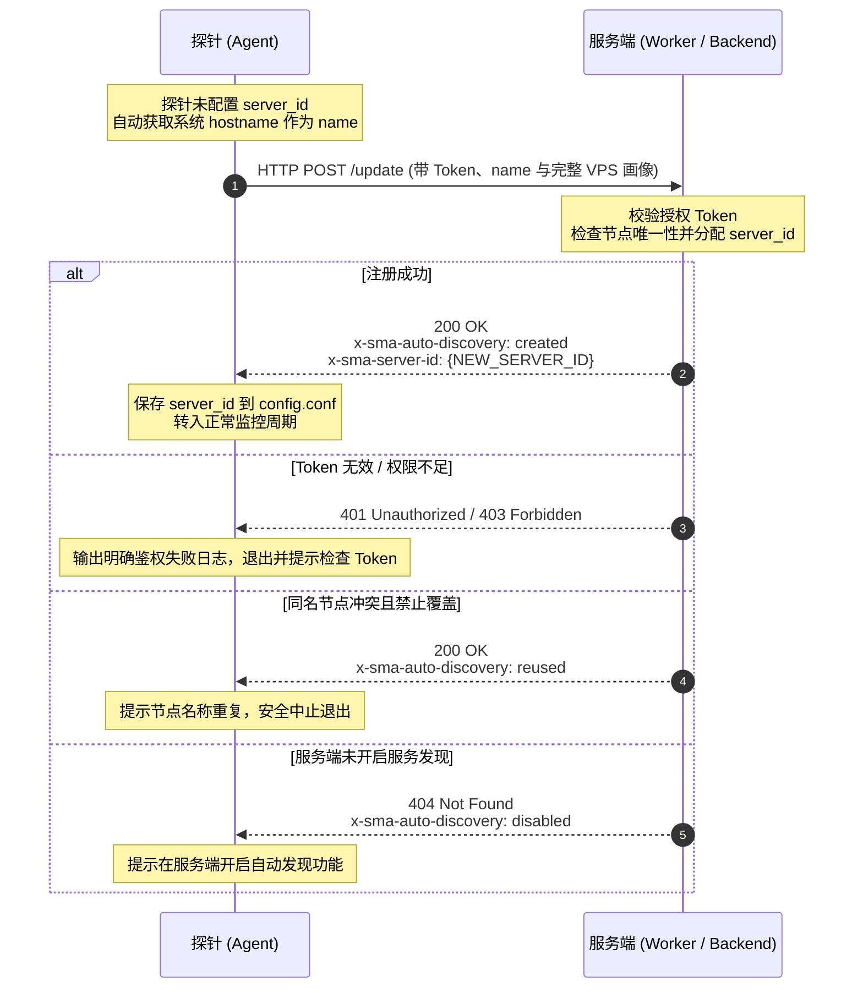
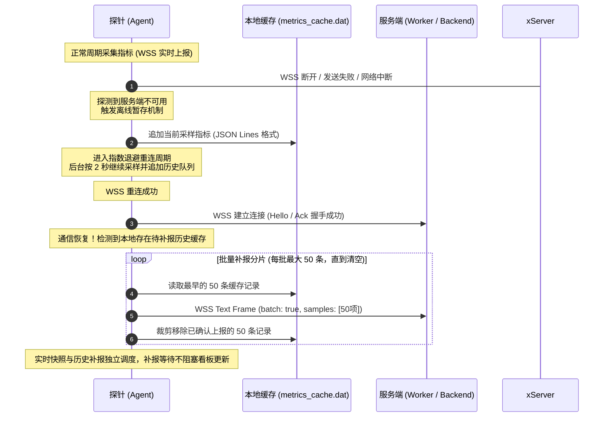

# Serverless Monitor Agent 通信与交互协议规范

本文档制定了 **Serverless Monitor Agent (`sma`)** 与服务端（例如 Cloudflare Worker 或自建后端）之间的完整交互协议规范。

---

## 1. 协议设计理念与架构

```
┌────────────────────────────────────────────────────────┐
│             Serverless Monitor Agent (sma)             │
│                                                        │
│  ┌──────────────────┐           ┌───────────────────┐  │
│  │ 指标采集引擎     │           │ 本地缓存引擎      │  │
│  │ (CPU/RAM/IO/Net) │           │ (metrics_cache)   │  │
│  └────────┬─────────┘           └────────▲──────────┘  │
│           │                              │             │
│           ▼                              │ 离线暂存    │
│  ┌───────────────────────────────────────┴──────────┐  │
│  │ 传输调度器 (Transport Manager)                   │  │
│  │  - 实时推送与批量补报: WebSocket (WSS) 长连接    │  │
│  │  - 服务发现自动注册: HTTP POST 短连接            │  │
│  └──────────────────────┬───────────────────────────┘  │
└─────────────────────────┼──────────────────────────────┘
                          │ TLS 加密通信
                          ▼
┌────────────────────────────────────────────────────────┐
│         服务端 (Worker / Serverless Backend)           │
│  - 授权校验 (Token)                                     │
│  - 节点服务发现与动态建号 (Auto Discovery)             │
│  - 实时与历史批次指标入库 (D1 / KV / ClickHouse)        │
│  - 动态下发采集配置 (Dynamic Config Push)              │
└────────────────────────────────────────────────────────┘
```

### 核心特性
1. **服务发现式极简注册**：无需预先在后台手工创建节点获取 `SERVER_ID`。安装探针时只需提供服务端授权 Token，探针自动上报 VPS 完整硬件与系统画像，服务器名称默认取操作系统主机名（`hostname`），服务端校验 Token 后自动分配 ID 并返回。
2. **通信故障本地缓存与批量补报**：当网络中断、服务端异常（超时/断连）时，探针自动将采样的指标落盘暂存到本地持久化缓存文件（`metrics_cache.dat`），探测到服务端恢复连接后，以批次形式（每批最多 50 条）通过 WSS 自动将历史数据全量补报，保证监控曲线不中断、不丢点。
3. **极简低开销架构**：日常监控统一采用 WebSocket (WSS) 全双工长连接通道，实现亚秒级极低延迟指标上报与服务端动态配置秒级推送；仅在未配 ID 的冷启动时使用 HTTP POST 进行一次性服务发现登记。

---

## 2. 通用通信规范

### 2.1 协议端点
- **HTTP 上报地址**：例如 `https://example.com/update`
- **WebSocket 上报地址**：自动将 HTTP 转换为 WSS 协议，例如 `wss://example.com/update`

### 2.2 公共请求头 (Client Request Headers)
所有 HTTP POST 请求及 WebSocket 握手请求均附带以下请求头：

| 请求头 | 类型 | 示例值 | 说明 |
| :--- | :--- | :--- | :--- |
| `Content-Type` | String | `application/json` | 数据编码格式 |
| `User-Agent` | String | `cfsm` | 客户端标识 |
| `X-Agent-Version` | String | `1.0.0` | Agent 版本号 |
| `X-Agent-Config-Schema` | String | `1` | 客户端支持的配置 Schema 版本 |
| `X-Agent-Config-Md5` | String | `c4ca4238a0b923820dcc509a6f75849b` | 客户端本地当前配置的 MD5 摘要 |

### 2.3 公共响应头 (Server Response Headers)
服务端返回以下控制性 Header：

| 响应头 | 示例值 | 说明 |
| :--- | :--- | :--- |
| `Date` | `Thu, 23 Oct 2026 11:00:00 GMT` | HTTP 标准时间，供 Agent 动态校准单机时钟漂移 |
| `x-sma-auto-discovery` | `created` / `reused` / `failed` / `disabled` | 服务发现建号状态标记 |
| `x-sma-server-id` | `srv-us-east-01` | 服务端自动建号分配的服务器 ID |
| `x-agent-wss-mode` | `active` / `inactive` / `disabled` | 服务端下发的 WSS 连接调度指令 |
| `x-agent-wss-reason` | `wss_schedule_inactive` | WSS 调度变更原因 |

---

## 3. 服务发现式注册协议 (Service Discovery Registration)

探针安装或首次启动未配置 `server_id` 时，自动进入服务发现注册流程。

### 3.1 注册交互时序图



### 3.2 注册请求报文 (Request Payload)
- **请求方式**：`POST`
- **Payload**：
```json
{
  "id": "",
  "secret": "YOUR_AUTH_TOKEN",
  "name": "hk-node-prod-01",
  "time": {
    "local_ts": 1729700000000,
    "offset_ms": 0,
    "calibrated": false
  },
  "collect_interval": 0,
  "report_interval": 60,
  "config_schema": "1",
  "config_md5": "none",
  "metrics": {
    "os": "Linux",
    "arch": "amd64",
    "kernel_version": "6.5.0-44-generic",
    "cpu_info": "AMD EPYC 7763 64-Core Processor",
    "cpu_cores": "4",
    "ram_total": "8192",
    "ram_used": "1024",
    "swap_total": "2048",
    "swap_used": "0",
    "disk_total": "80000",
    "disk_used": "12000",
    "boot_time": "1729600000000",
    "load_avg": "0.15 0.20 0.18",
    "processes": "142",
    "tcp_conn": "58",
    "udp_conn": "12",
    "net_in_speed": "0",
    "net_out_speed": "0",
    "net_rx": "10485760",
    "net_tx": "5242880",
    "net_rx_monthly": "10485760",
    "net_tx_monthly": "5242880",
    "ip_v4": "0",
    "ip_v6": "0",
    "gpu_info": []
  }
}
```

#### 关键字段约定
- `id`：注册阶段必须保持为空字符串 `""`。
- `secret`：服务端授权 Token（命令行 `-token=...` 或 `-secret=...` 传入）。
- `name`：节点名称。未显式传入时，探针自动调用内核或系统接口提取本机的主机名（`hostname`）。

---

## 4. 常规指标上报协议 (Regular Metrics Reporting)

建号成功后，HTTP/旧版路径按配置的 `report_interval`（默认 60 秒）上报。`connection_mode: auto` 的 WSS 自适应模式按专题规范中的 `realtimeHint` 与 `nextWssReportAfterMs` 调度；专题规范优先于本节的旧版周期描述。

### 4.1 上报请求报文
```json
{
  "id": "srv-us-east-01",
  "secret": "YOUR_AUTH_TOKEN",
  "time": {
    "local_ts": 1729700060000,
    "offset_ms": 12,
    "calibrated": true,
    "round_trip_ms": 48
  },
  "collect_interval": 0,
  "report_interval": 60,
  "config_schema": "1",
  "config_md5": "c4ca4238a0b923820dcc509a6f75849b",
  "metrics": {
    "cpu": "12.50",
    "ram_total": "8192",
    "ram_used": "1536",
    "swap_total": "2048",
    "swap_used": "0",
    "disk_total": "80000",
    "disk_used": "12050",
    "disk": {
      "read_bps": 102400,
      "write_bps": 204800,
      "read_iops": 15.2,
      "write_iops": 32.1,
      "await_ms": 1.25,
      "util": 3.4
    },
    "load_avg": "0.32 0.28 0.20",
    "boot_time": "1729600000000",
    "net_in_speed": "125000",
    "net_out_speed": "84000",
    "net_rx": "10610760",
    "net_tx": "5326880",
    "net_rx_monthly": "10610760",
    "net_tx_monthly": "5326880",
    "os": "Linux",
    "arch": "amd64",
    "kernel_version": "6.5.0-44-generic",
    "cpu_info": "AMD EPYC 7763 64-Core Processor",
    "cpu_cores": "4",
    "gpu_info": [],
    "processes": "145",
    "tcp_conn": "62",
    "udp_conn": "14",
    "ip_v4": "203.0.113.1",
    "ip_v6": "2001:db8::1",
    "ping_ct": "35",
    "ping_cu": "42",
    "ping_cm": "38",
    "ping_bd": "15",
    "loss_ct": 0,
    "loss_cu": 0,
    "loss_cm": 0,
    "loss_bd": 0
  }
}
```

### 4.2 服务端动态配置推送
服务端返回 `200 OK` 时，响应 Body 可携带最新的动态配置 JSON，例如：
```json
{
  "report_interval": 30,
  "collect_interval": 5,
  "connection_mode": "auto",
  "ping_mode": "tcp",
  "ct_node": "ct.example.com:80",
  "cu_node": "cu.example.com:80",
  "cm_node": "cm.example.com:80",
  "bd_node": "bd.example.com:80"
}
```
Agent 接收并校验通过后，即时热更新本地运行时配置并持久化，下个周期生效。

---

## 5. 本地缓存与批量补报容灾协议 (Offline Caching & Batch Backfill)

当服务端出现网络割接、突发故障、短暂停机或返回 5xx 状态时，探针触发自动容灾机制。

### 5.1 容灾交互时序图



### 5.2 本地缓存文件格式
- **路径**：`~/.sma/metrics_cache.dat`（普通用户）或 `/usr/local/etc/sma/metrics_cache.dat`（系统服务）。
- **格式**：JSON Lines，每行一个独立 JSON 样本；在线、空闲和断线采样共用队列。启动及追加时修复截断尾行，计数和确认统一按有效样本处理。
- **单行结构**：
```json
{"ts":1729700060000,"metrics":{"cpu":"15.20","ram_total":"8192","ram_used":"1600","swap_total":"2048","swap_used":"0","net_in_speed":"45000","net_out_speed":"32000"}}
```
- **容量上限与淘汰策略**：
  - 默认最多保留 `5000` 条采样记录。可保留时长取决于实际采样间隔：60 秒一条约 3.47 天；自适应模式按 2 秒一条采样时约 2.78 小时。部署方应按所需离线恢复时长配置缓存容量。
  - 超过上限后采用先进先出（FIFO）自动淘汰最老数据，保证宿主机磁盘安全。

### 5.3 批量补报报文 (Batch Report Payload)
通信恢复后，Agent 构造带有 `"batch": true` 的报文：

```json
{
  "id": "srv-us-east-01",
  "secret": "YOUR_AUTH_TOKEN",
  "reportId": "srv-us-east-01-00000042",
  "batch": true,
  "time": {
    "local_ts": 1729703660000,
    "offset_ms": 10,
    "calibrated": true
  },
  "samples": [
    {
      "ts": 1729700120000,
      "metrics": {
        "cpu": "18.30",
        "ram_total": "8192",
        "ram_used": "1620",
        "swap_total": "2048",
        "swap_used": "0",
        "net_in_speed": "52000",
        "net_out_speed": "41000"
      }
    },
    {
      "ts": 1729700180000,
      "metrics": {
        "cpu": "14.10",
        "ram_total": "8192",
        "ram_used": "1610",
        "swap_total": "2048",
        "swap_used": "0",
        "net_in_speed": "31000",
        "net_out_speed": "28000"
      }
    }
  ]
}
```

- HTTP 补报以 2xx 响应确认；WSS 补报以专题规范中的 `ackFor:"report"`、匹配的 `reportId`、`persisted:true` 和完整 `acceptedSamples` 确认。Agent 只删除已确认条目；若补报过程中断，未确认条目依然保留在磁盘中。服务端对重复 `reportId` 必须幂等。

---

## 6. WebSocket 长连接子协议 (WebSocket Sub-Protocol)

当配置为 `connection_mode: auto`（默认）且已有 `server_id` 时，Agent 与服务端建立 WSS 长连接通道。

### 6.1 握手与 Query 参数
WSS URL 附带版本与配置校验参数：
`wss://example.com/update?config_schema=1&config_md5=c4ca4238a0b923820dcc509a6f75849b`

### 6.2 协议交互帧
> 💡 **自适应动态上报技术规范**：关于无访客时低频批量（60s）节能上报、有访客时毫秒级提速（2s）实时推流的双模调度架构与 Cloudflare WebSocket Hibernation 详细实现，请参阅专题文档：[ADAPTIVE_REPORTING_SPEC.md](ADAPTIVE_REPORTING_SPEC.md)。

1. **服务端 Hello 帧**：
   Agent 连上后，服务端首帧必须返回 `hello`。启用自适应模式时还必须携带当前 `realtimeHint`、`nextWssReportAfterMs` 和 `modeRevision`，格式以 [自适应动态上报规范](ADAPTIVE_REPORTING_SPEC.md) 为准：
   ```json
   {
     "type": "hello",
     "protocol": "update",
     "ts": 1729700000000,
     "realtimeHint": false,
     "nextWssReportAfterMs": 60000,
     "modeRevision": 1
   }
   ```
2. **客户端实时上报**：
   通过 WebSocket 发送文本格式的完整 Metrics JSON Payload。
3. **服务端报告确认与模式推送**：
   专题规范要求服务端将报告确认和模式变化明确区分，不能用一条旧报告 ACK 覆盖较新的模式。下面示例是看板状态变化时的模式推送：
   ```json
   {
     "type": "ack",
     "ackFor": "mode",
     "ts": 1729700000000,
     "modeRevision": 2,
     "nextWssReportAfterMs": 2000,
     "realtimeHint": true
   }
   ```
   报告 ACK 使用 `ackFor:"report"` 并回显 `reportId`；批量持久化确认语义见专题规范。
   - `nextWssReportAfterMs`：模式推送对 Agent 下一次上报时间的建议。
   - `realtimeHint`：指示当前是否处于仪表盘实时查看模式。

---

## 7. 错误代码与处置标准

| HTTP 状态码 | 自定义标头 / 错误提示 | 客户端处置行为 |
| :--- | :--- | :--- |
| `200 OK` | `x-sma-auto-discovery: created` | 建号成功，提取 `x-sma-server-id` 写入配置，重置退避计数器 |
| `200 OK` | `x-sma-auto-discovery: reused` | 节点同名冲突，Agent 安全终止退出，不无限重启 |
| `401 Unauthorized` | 无效 Token | 鉴权失败，记录 ERROR 日志，终止建号 |
| `404 Not Found` | 未开启自动发现（空 ID 请求） | 提示服务端开启「自动发现」，退出运行 |
| `429 / 5xx / 网络超时` | 触发指数退避 | 暂停网络请求，将采样写入本地 `metrics_cache.dat`，等待恢复后批量补报 |
